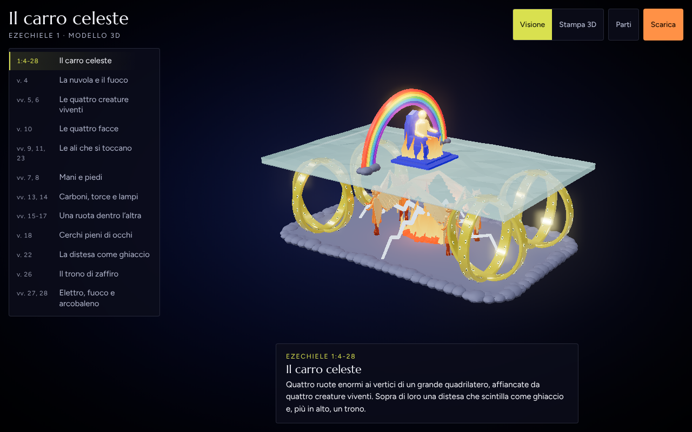

# Il carro celeste

Modello 3D parametrico del carro celeste descritto in Ezechiele 1: si esplora nel browser e si scarica per la stampa 3D. Vive in questa cartella ed è indipendente dal gioco del repository.

Si apre dal web qui: <https://claude.ai/artifact/2By3PSNDFpRXZT5756A5QW> (pagina privata del proprietario, da condividere dal suo menu Share). Stato del lavoro, scelte fatte e rifiniture possibili sono in [`HANDOFF.md`](HANDOFF.md).



## Che cosa contiene

| File                                                     | A cosa serve                                                           |
| -------------------------------------------------------- | ---------------------------------------------------------------------- |
| [`modelli/carro-celeste.stl`](modelli/carro-celeste.stl) | Modello in un pezzo unico, solido chiuso, circa 246 × 156 × 134 mm     |
| [`modelli/kit/`](modelli/kit)                            | Lo stesso modello in cinque parti, ognuna già orientata per il piatto  |
| [`modelli/carro-celeste.glb`](modelli/carro-celeste.glb) | Modello a colori per il visualizzatore web e per l’AR                  |
| [`index.html`](index.html)                               | Visualizzatore web: dettagli per versetto, vista di stampa, download   |
| [`src/`](src)                                            | Generatore del modello: ogni misura è un parametro in `src/params.mjs` |

Su GitHub i file `.stl` del kit si aprono direttamente in 3D dalla pagina del file.

## Dettagli della visione nel modello

| Versetti  | Nel modello                                                                                                                                    |
| --------- | ---------------------------------------------------------------------------------------------------------------------------------------------- |
| 4         | Base orlata dalla grande nuvola; fuoco al centro                                                                                               |
| 5, 6      | Quattro creature viventi dall’aspetto umano, ognuna con quattro facce e quattro ali                                                            |
| 7         | Gambe diritte, zoccoli di vitello (nel visualizzatore color rame lucido)                                                                       |
| 8         | Una mano umana sotto le ali su ognuno dei quattro lati                                                                                         |
| 9, 11, 23 | Due ali spiegate verso l’alto che toccano quelle delle creature vicine; due che coprono i lati del corpo                                       |
| 10        | Faccia d’uomo davanti, di leone a destra, di toro a sinistra, d’aquila dietro                                                                  |
| 13, 14    | Carboni ardenti, torce di fuoco fra le creature, lampi che escono dal fuoco                                                                    |
| 15-17     | Quattro ruote a terra ai vertici di un rettangolo, una accanto a ogni creatura; ognuna è fatta di due cerchi uguali incrociati ad angolo retto |
| 18        | Cerchi molto alti, a fascia larga, con file di occhi sulla faccia esterna e su quella interna                                                  |
| 22        | Distesa a lastra rettangolare spessa, sfaccettata come ghiaccio, sopra le teste delle creature                                                 |
| 26        | Trono tagliato come una pietra di zaffiro, con una figura seduta priva di lineamenti                                                           |
| 27, 28    | Fiamme dai fianchi in giù; arcobaleno di sette fasce con i piedi fra le nubi                                                                   |

Il testo seguito è quello di Ezechiele 1 nella _Traduzione del Nuovo Mondo_ (edizione per lo studio) su jw.org, con le sue note in calce; per la disposizione generale (ruote lontane fra loro ai vertici di un quadrilatero, cerchi a fascia dello stesso diametro, lastra rettangolare molto al di sopra delle creature) sono stati seguiti i capitoli 3 e 4 del libro _La pura adorazione di Geova: finalmente ristabilita!_ e le sue illustrazioni.

Nella visione nulla sostiene fisicamente la distesa sopra le ruote. Per poterlo stampare, nel modello la distesa poggia sulle quattro ruote e le creature poggiano sulla base.

## Usarlo

```bash
cd carro-celeste
```

```bash
npm install
```

```bash
npm run serve
```

Poi apri `http://localhost:5180/`. Il visualizzatore non ha bisogno di compilazione: `web/app.bundle.js` e i file in `modelli/` sono già nel repository.

Per rigenerare tutto dopo una modifica:

```bash
npm run build
```

`npm run build:model` ricostruisce STL, kit e GLB (circa 15 secondi); `npm run build:web` ricompila il visualizzatore.

## Stampa

- **Pezzo unico**: resina, oppure FDM con supporti ad albero. Strato 0,12–0,16 mm.
- **Kit**: strato 0,12–0,2 mm, ugello 0,4 mm. Le ruote si stampano in piedi, in quattro copie, con supporti solo dentro i cerchi. La distesa rende bene in PETG o PLA trasparente, il trono in blu.
- **Montaggio del kit**: le ruote entrano nelle sedi della base, la distesa si appoggia sulle ruote, trono e arcobaleno entrano nelle sedi della distesa (gioco di 0,25 mm).
- A grandezza nominale serve un piatto da 250 mm. Il modello si può scalare liberamente nello slicer: 89% per un piatto da 220 mm, 73% per uno da 180 mm.
